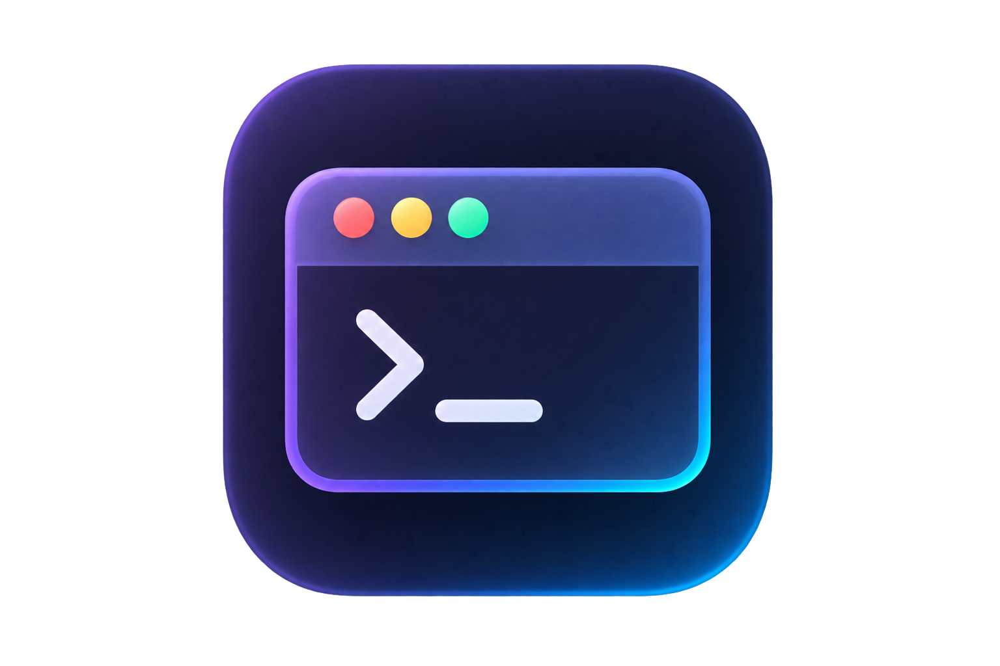

# VEGA IDE

<p align="center">
  
</p>

**VEGA IDE** — редактор кода со встроенными AI-агентами. Форк открытого кода
[Microsoft VS Code](https://github.com/microsoft/vscode) (Code - OSS, ветка `release/1.147`),
в котором вся AI-функциональность переведена на **[VEGA](https://vega.codes)** — единый доступ
к языковым моделям через `api.vega.chat` (OpenRouter-совместимый прокси).

## Отличия от VS Code

| | VS Code | VEGA IDE |
|---|---|---|
| Вход в AI | GitHub-аккаунт / GitHub Copilot | Аккаунт VEGA, device flow (RFC 8628) через `api.vega.chat` — расширение `vega-authentication` |
| Модели и оплата | Каталог Copilot | Каталог `api.vega.chat`, ключ `sk-apivega-…`, тарифы и цены VEGA в модель-пикере |
| Вызовы моделей | `api.githubcopilot.com` | `api.vega.chat/api/v1` с OpenRouter-заголовками атрибуции (`HTTP-Referer`, `X-OpenRouter-Title`, `X-OpenRouter-Categories`) |
| Язык по умолчанию | English | **Русский** — пакет встроен в сборку, ничего ставить не нужно |
| Маркетплейс расширений | Visual Studio Marketplace | [Open VSX](https://open-vsx.org) |
| Темы и шрифт | Default Dark/Light | **VEGA Dark / VEGA Light** (по умолчанию), шрифт **Google Sans** |
| Брендинг | Visual Studio Code | VEGA IDE: имя, иконка, `vegaide://` протокол |
| Данные и установка | `~/.vscode*` | `~/.vegaide`, `.vegaide-server`, свой mutex и AppUserModelId в Windows — **ставится рядом с VS Code без конфликтов** |
| Лицензия сборки | Microsoft EULA | [EULA VEGA IDE](https://vega.codes/offer) |

Что сохранено без изменений: вся функциональность Code - OSS, технические идентификаторы
(`github.copilot*`, `provider.id: 'vega'`), GitHub-аутентификация для git/scm (issues,
credentials). Осознанное ограничение: GitHub-функции внутри агент-сессий (репозитории, PR,
GitHub Environments) в VEGA не работают.

## Установка

**Windows x64:** скачайте `VEGAIDE-<версия>-x64-user-setup.exe` на странице
[Releases](https://github.com/lingeniare/vegaide/releases) и запустите установщик.

## Сборка из исходников

Требования (как у upstream VS Code):

- Node.js **24.22.1** (см. `.nvmrc`; удобно через [fnm](https://github.com/Schniz/fnm) или nvm)
- pnpm **12.16.0**
- Python и C++ Build Tools — см. [How to Contribute](https://github.com/microsoft/vscode/wiki/How-to-Contribute)

```bat
pnpm install
pnpm run compile        :: клиент + расширение Copilot
scripts\code.bat        :: dev-запуск (в dev-режиме интерфейс всегда английский)
```

### Windows-инсталлятор

```bat
:: signtool.exe из Windows SDK должен быть в PATH
pnpm run gulp vscode-win32-x64-min            :: полная сборка → ..\VSCode-win32-x64
pnpm run gulp vscode-win32-x64-inno-updater
pnpm run gulp vscode-win32-x64-user-setup     :: → .build\win32-x64\user-setup\VSCodeSetup.exe
```

Инкрементальная пересборка при уже собранном бандле: `pnpm run gulp vscode-win32-x64-min-ci`.
Подробности и подводные камни упаковки — в [AGENTS.md](AGENTS.md).

## Тесты

```bat
scripts\test.bat --run src\vs\<путь>\<файл>.test.ts   :: юнит-тесты src/vs (Electron)
pnpm run test-node                                    :: node-тесты
pnpm -C extensions\copilot exec vitest --run          :: юнит-тесты расширения copilot
```

## Документация

- [CHANGELOG.md](CHANGELOG.md) — история версий форка
- [AGENTS.md](AGENTS.md) — карта брендинга, сборки и изоляции для AI-агентов
- [.github/copilot-instructions.md](.github/copilot-instructions.md) — архитектура и гайдлайны upstream
- [connect-app.md](connect-app.md) — как подключить своё приложение к `api.vega.chat`
- [CONTRIBUTING.md](CONTRIBUTING.md), [SECURITY.md](SECURITY.md)

## License

Код базы Code - OSS — [MIT](LICENSE.txt) (Microsoft). Продукт, бренд и сборки VEGA IDE
распространяются по [EULA VEGA IDE](https://vega.codes/offer).
