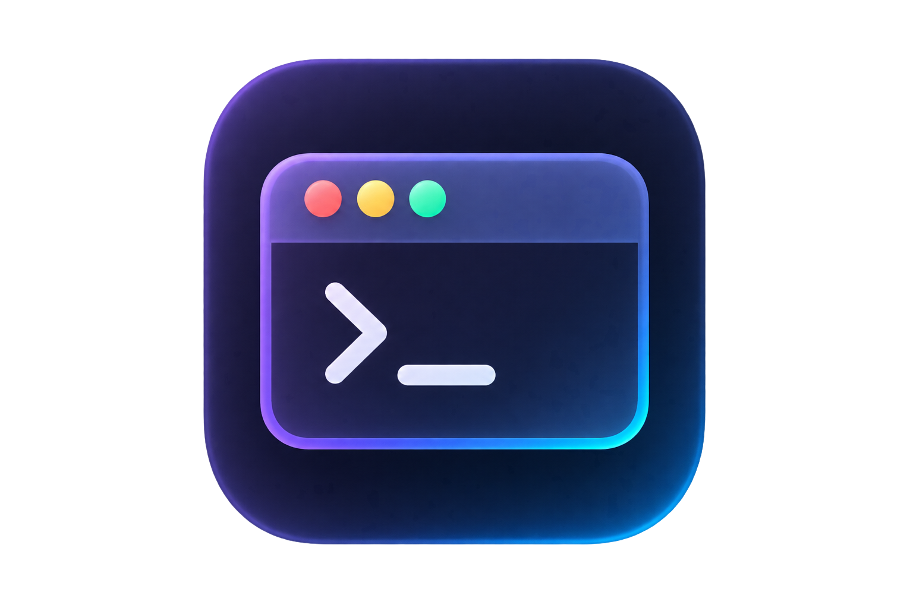

  

<h1 align="center">VEGA IDE</h1>

  Редактор кода, в котором ИИ — не плагин, а ядро. 
  Форк <a href="https://github.com/microsoft/vscode">Code-OSS</a> с провайдером <a href="https://vega.chat">ВЕГА</a> вместо GitHub Copilot.

  <b>RU</b> &nbsp;·&nbsp; <a href="README_EN.md">EN</a>

  
  
  
  

 

## Что это

**VEGA IDE** — независимая сборка VS Code, в которой весь ИИ-стек переведён на российского провайдера [ВЕГА](https://vega.chat). Тот же знакомый редактор — та же сетка редактора, терминал, отладчик, расширения Open VSX — но с другой моделью доступа к ИИ: без VPN, без зарубежной карты, без передачи телеметрии.

## Отличия от VS Code + GitHub Copilot

| | VS Code + Copilot | VEGA IDE |
|---|---|---|
| **Модели** | Только каталог GitHub Copilot, платная подписка | API ВЕГА — все новые модели в одном месте; бесплатные модели для кодинга **до 1000 запросов в сутки** |
| **Поиск в интернете** | Ограничен | Встроенные web-search и web-fetch на базе Parallel AI |
| **Документация в контексте** | Нет | Context7 и Devin DeepWiki — актуальные доки библиотек прямо в промпте агента |
| **Персональные данные** | Обрабатываются за рубежом | Соответствие **152-ФЗ** |
| **Доступность** | Гео-ограничения, нужен VPN | Работает без VPN и региональных блокировок |
| **Стоимость запросов** | Каждый запрос тарифицируется | Кэширование запросов — лимиты расходуются экономнее |
| **Аналитика** | Телеметрия Microsoft | Веб-аналитика вырезана полностью |
| **Оплата** | Зарубежная карта | Рубли |

## Что внутри

- **Полный редактор Code-OSS** — синхронизируемся с upstream `microsoft/vscode`
- **ИИ-чат и агенты** через провайдер `api.vega.chat` — OpenRouter-совместимый прокси ко всем актуальным моделям
- **Русский интерфейс из коробки** — языковой пакет встроен, английский доступен переключением
- **MCP-серверы, агенты, инструкции, хуки** — вся система кастомизации агентов из Code-OSS
- **Изолированные данные** — VEGA IDE ставится рядом с VS Code и не делит с ним настройки, расширения и профили

## Установка

Готовые сборки публикуются на [vega.chat](https://vega.chat). Сборка из исходников — по [инструкции upstream](https://github.com/microsoft/vscode/wiki/How-to-Contribute#build-and-run-from-source) (Node.js + npm, `npm install` → `npm run watch` → `scripts\code.bat` / `./scripts/code.sh`).

## Обратная связь и вклад

- **Баги и идеи** — [Issues](https://github.com/lingeniare/vegaide/issues), принимаем.
- **Pull request'ы с кодом** — не принимаем: репозиторий ведёт одна команда, чужие правки не сольются.
- **Уязвимости** — не пишите в Issues, сообщайте приватно через [Security Advisories](https://github.com/lingeniare/vegaide/security/advisories/new) ([политика](SECURITY.md)).

## Правовое

- Исходный код этого репозитория — под [лицензией MIT](LICENSE.txt), унаследованной от Code-OSS.
- Собранный продукт VEGA IDE распространяется по [EULA](LICENSE.rtf).
- Проект независим и не аффилирован с Microsoft и GitHub; «VS Code» — товарный знак Microsoft.

---

  <a href="https://vega.chat">vega.chat</a> &nbsp;·&nbsp; <a href="https://api.vega.chat">api.vega.chat</a> &nbsp;·&nbsp; <a href="https://github.com/lingeniare/vegaide/issues">issues</a>

