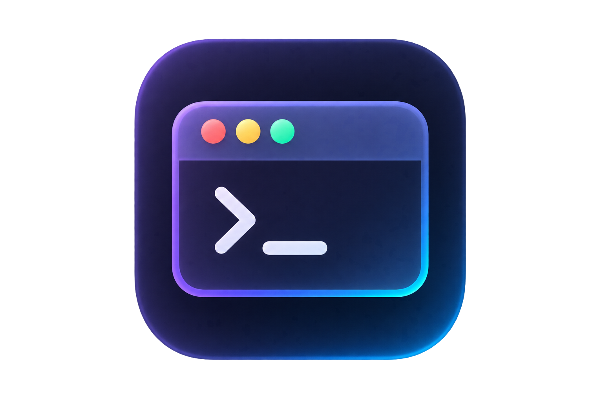

  

<h1 align="center">VEGA IDE</h1>

  A code editor where AI is the core, not a plugin. 
  A <a href="https://github.com/microsoft/vscode">Code-OSS</a> fork powered by the <a href="https://vega.chat">VEGA</a> provider instead of GitHub Copilot.

  <a href="README.md">RU</a> &nbsp;·&nbsp; <b>EN</b>

  
  
  
  

 

## What is this

**VEGA IDE** is an independent VS Code build with its entire AI stack rerouted to the [VEGA](https://vega.chat) provider. The same familiar editor — same editing surface, terminal, debugger, Open VSX extensions — but a different access model for AI: no VPN, no foreign bank card, no telemetry sent abroad.

## How it differs from VS Code + GitHub Copilot

| | VS Code + Copilot | VEGA IDE |
|---|---|---|
| **Models** | GitHub Copilot catalog only, paid subscription | VEGA API — every new model in one place; free coding models, **up to 1,000 requests per day** |
| **Web search** | Limited | Built-in web-search and web-fetch powered by Parallel AI |
| **Docs in context** | None | Context7 and Devin DeepWiki — up-to-date library docs injected into the agent's prompt |
| **Personal data** | Processed abroad | Compliant with Russian law **152-FZ** on personal data |
| **Availability** | Geo-restricted, VPN required | Works without VPN or regional blocks |
| **Request cost** | Every request billed | Request caching stretches your quota further |
| **Analytics** | Microsoft telemetry | All web analytics stripped out |
| **Payment** | Foreign bank card | Rubles |

## Inside

- **The full Code-OSS editor** — kept in sync with upstream `microsoft/vscode`
- **AI chat and agents** through `api.vega.chat` — an OpenRouter-compatible proxy to all current models
- **Russian UI out of the box** — bundled language pack; English available via language switch
- **MCP servers, agents, instructions, hooks** — the complete agent customization system from Code-OSS
- **Isolated data** — VEGA IDE installs side-by-side with VS Code and shares no settings, extensions or profiles with it

## Install

Ready builds are published at [vega.chat](https://vega.chat). To build from source, follow the [upstream guide](https://github.com/microsoft/vscode/wiki/How-to-Contribute#build-and-run-from-source) (Node.js + npm, `npm install` → `npm run watch` → `scripts\code.bat` / `./scripts/code.sh`).

## Feedback & contributing

- **Bugs and ideas** — welcome in [Issues](https://github.com/lingeniare/vegaide/issues).
- **Code pull requests** — not accepted: the repository is maintained by a single team and external changes won't be merged.
- **Vulnerabilities** — please don't file public issues; report privately via [Security Advisories](https://github.com/lingeniare/vegaide/security/advisories/new) (see [policy](SECURITY.md)).

## Legal

- The source code in this repository is under the [MIT license](LICENSE.txt), inherited from Code-OSS.
- The built VEGA IDE product is distributed under a [EULA](LICENSE.rtf).
- This is an independent project, not affiliated with Microsoft or GitHub; "VS Code" is a trademark of Microsoft.

---

  <a href="https://vega.chat">vega.chat</a> &nbsp;·&nbsp; <a href="https://api.vega.chat">api.vega.chat</a> &nbsp;·&nbsp; <a href="https://github.com/lingeniare/vegaide/issues">issues</a>

